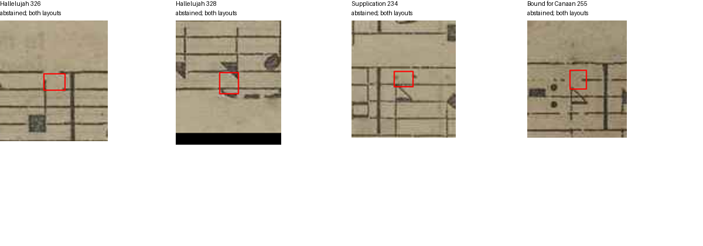

# Damaged-head abstention: untouched 1860 validation

**The conservative revision fixes the development head loss, but this holdout
does not establish damaged-head generalization.** It made no non-head deletions
and retained four artifacts. No previously unseen genuine damaged head was
rescued in this sample. The resulting disagreement scores are slightly worse;
the rule was not retuned after this outcome.

## What changed before the holdout

The earlier line/blemish rule treated absence of a compact component or enclosed
counter as evidence of no head. The revision removes that inference. A broader
rejection now requires all candidate ink to be explained by thin staff lines
with independent support outside the box on both sides. **Any unexplained ink
triggers abstention**, without a new minimum fragment size, rim classifier,
book-specific rule or source-ID exception. Exterior support bounds are the
existing verifier's staff-space bounds. The older, narrow empty-box rejection,
repeat-dot and beam rules remain unchanged.

The development controls use the already examined 1870/1911 material, including
damaged Aylesbury 186 and ambiguous Kedron 219. Those are not holdout successes.
Synthetic open arcs, corners, stems and single off-line pixels were checked at
several scales. Some known artifacts, including JPK Jackson 256, are deliberately
retained rather than fitted with a special rejection rule.

Before target inspection, **214 tests passed**. Saved-reading recovery preserved
all **18 protected JPK heads and 17 reviewed durations**, Ninety-Third Psalm's
printed 3/4 and fourteen flagged six-quarter columns, and Lenox/Ragan/Duane's
zero-overflow controls. Jackson's affected bar is unresolved again. This is a
documented conservatism cost, not a new source-correct note.

The revised engine is `damaged-head-abstention-c291185f6a20`, containing 152 frozen
Python files. The prior engine is the unchanged `b6512a5f402d` checkpoint. The
Copisteria implementation and 1911 JPK meter-template arrays are unchanged.

## Holdout procedure

All 19 available matched source crops from the supplied 1860-labeled PDF were
selected earlier by the other chat. Missing pages, crop boundaries, voice order
and edition caveats remain in the copied manifest. Both layouts were retained:
**38 configurations, 38 fresh CPU_ONLY baseline captures and 76 policy outputs**.

The source selection and [acceptance protocol](../../source-sets/1860-abstention-holdout-20261126/PROTOCOL.md)
were fixed before target evaluation. All captures and both policy runs completed
under source/code/model/template hash guards before reference scoring. No rule
was altered after seeing target data. Human source judgments were written to
`source-review.json` and their SHA-256 recorded in
`source-review-before-score.sha256` **before opening reference scores**.

Only `id` and input path enter prediction. Expected voices/meters and 2025 XML
are not prediction inputs. Voice mapping and absent-alto exclusion apply only
to scoring. This tests postprocessing on baseline event pools, not the upstream
JPK proposal and system-reflow experiments. The supplied edition label comes
from the user's date/filename; the PDF has no title page, as its metadata notes.

## Every held-out filter effect

The revised policy rejected **zero** source objects as non-heads. It abstained
on **four distinct objects**, each in both layouts (eight occurrences), that
the earlier line/blemish filter rejected. No retained note's duration, dots,
type or pitch changed between snapshots. The only changed common cut is
Supplication column 12, **4 → 5.5 quarters**, in both layouts.



| Tune | Symbol | Source review |
|---|---:|---|
| Hallelujah | 326 | Upper stem/staff intersection above a square head; no independent head in the candidate box |
| Hallelujah | 328 | Extra lower edge/stem-line interpretation below the separately selected triangular head 179 |
| Supplication | 234 | Staff/upper stem region above the separately selected real head 162 |
| Bound for Canaan | 255 | Staff/upper stem region above the separately selected hollow head 230, beside repeat dots |

All four are artifacts or extra interpretations of another object, rather than
new genuine heads. Their small unexplained residuals (21, 37, 16 and 41 pixels)
cause the revised filter to retain them. These measurements are outcomes, not
new fitted cutoffs. Surrounding bar values and pitches are not fully adjudicated.

**Observed source-safety result:** no genuine-head deletion by the revision in
these configurations. **Coverage limitation:** because it deleted nothing, and
these four retained candidates are artifacts, the holdout does not directly
stress protection of a new genuine damaged head. It demonstrates the retention
cost, not a calibrated or broadly validated head classifier.

## Disagreement scores after source adjudication

| Layout | Baseline PD edits | Prior PD | Revised PD | Prior F1 | Revised F1 |
|---|---:|---:|---:|---:|---:|
| Default | 950 | 898 | 901 | .5242 | .5228 |
| Cleaned | 1196 | 1139 | 1143 | .4901 | .4887 |

Against the prior snapshot, PD is **0 better / 32 tied / 6 worse**; F1 is
**0 better / 33 tied / 5 worse** across the 38 paired configurations. The total
PD increase is seven edits across both layout settings. These are repeated
observations of the same nineteen tunes, not independent songs or an accuracy
estimate. Reference editions differ; source review controls the safety finding.

Three configurations have unequal part-measure spans in **both** versions:
Hallelujah in both layouts and Ocean in default layout. These existing
postprocessor/layout failures are retained and reported. The full applied
rhythm stage has lower F1 than the native baseline in this sample, so none of
these results supports broad enablement.

## Reproduction and integrity

Use the copied manifest and engine mapping under
`source-sets/1860-abstention-holdout-20261126/`. A new capture needs a new tag;
both replays must complete before scoring:

```sh
copisteria/.venv/bin/python benchmarks/crossbook-frozen-rules/run_abstention_holdout.py --phase capture --tag NEW_TAG
copisteria/.venv/bin/python benchmarks/crossbook-frozen-rules/run_abstention_holdout.py --phase replay --engine prior --tag NEW_TAG
copisteria/.venv/bin/python benchmarks/crossbook-frozen-rules/run_abstention_holdout.py --phase replay --engine current --tag NEW_TAG
copisteria/.venv/bin/python benchmarks/crossbook-frozen-rules/extract_source_changes.py benchmarks/crossbook-frozen-rules/runs/NEW_TAG
# Review and lock source decisions before scoring.
copisteria/.venv/bin/python benchmarks/crossbook-frozen-rules/score_results.py benchmarks/crossbook-frozen-rules/runs/NEW_TAG
```

CoreML compilation may require sandbox escalation. Scoring saved outputs needs
no new inference. The machine-readable checks record code/input/output hashes,
the pre-score review digest, development controls and this test's limitations.

**Recommended:** keep the stage opt-in and obtain a fresh, predeclared damaged-
head sample from another printing before claiming generalization. These 1860
cases must be treated as observed data for any later revision.

**Alternative:** use the conservative version with manual review of abstentions
and unresolved bars, accepting artifact retention. Defaults and gallery remain
unchanged. No thresholds were adjusted to improve these holdout scores.
