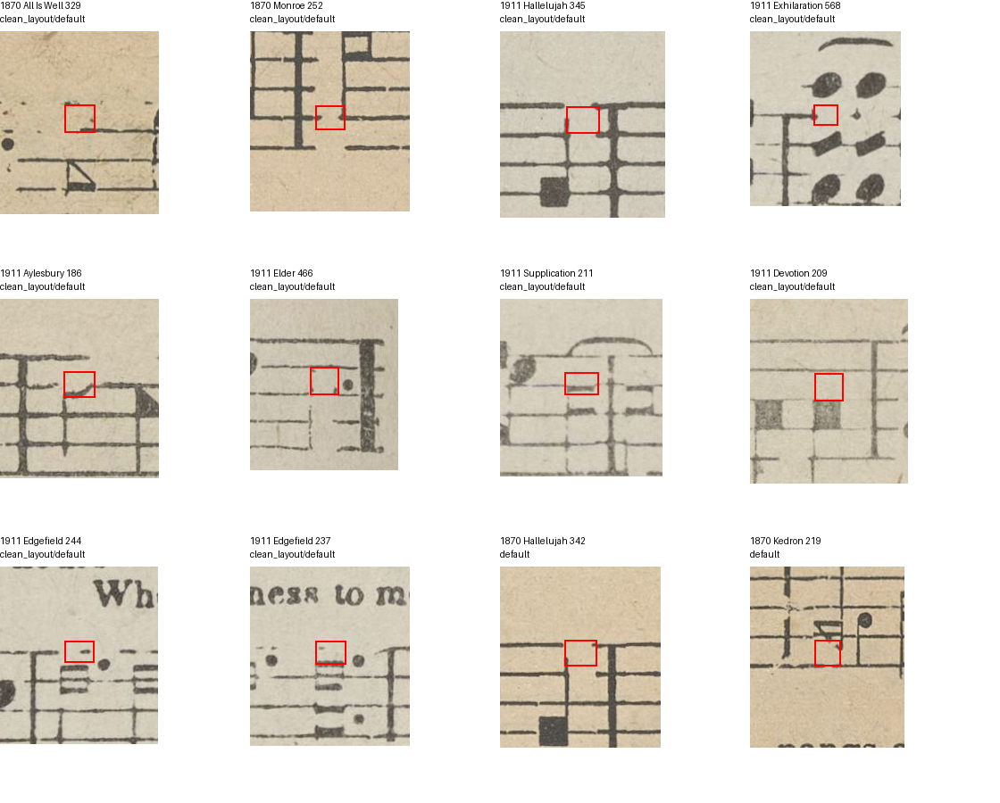
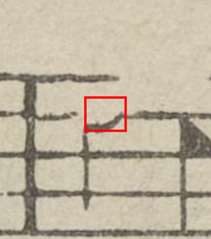
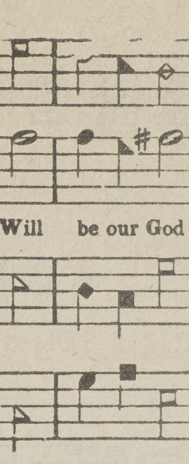
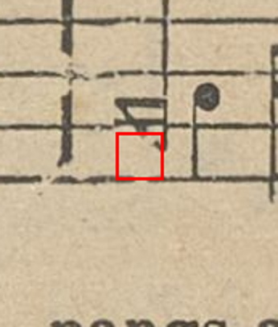

# Frozen rules: expanded cross-book source review

**The new line/blemish rule is not ready for general use: it deletes a genuine
damaged head in J. L. White's 1911 Aylesbury.** Broader testing finds useful
non-head rejections, but the confirmed source loss remains. No rule was tuned
after observing the pilot or expanded outputs.

## Scope and comparison

The test retains **26 matched tunes per book**, **52 source crops**, and both
layout settings: **104 configurations**. These include the original seven tunes
per book plus 19 added tunes per book selected by the other chat before new
inference. The added cohort is reported separately in `results.json`.

The baseline reader is frozen. Its 28 pilot captures were reused by source,
model, engine and output hashes; 76 additional CPU_ONLY cases were generated.
Each of the earlier and newer frozen rhythm versions then processed every
baseline reading, producing 208 policy outputs. All generation guards passed
before reference scoring. All configurations and outcomes are retained.

The engines are the immutable `final-a17498fc863d` and
`dot-head-evidence-20261126-b6512a5f402d` snapshots. Both use the same frozen 1911
JPK meter-template arrays. The adapter changes input-root/parent-event paths and
the taxonomy asset lookup, not rule bodies. No target meter, expected part count,
title, reference counts or source voice order enters prediction. Source voice
order and edition-absent alto information enter scoring only.

This tests frozen postprocessing on baseline event pools. It does not recreate
the upstream JPK missing-head proposals and source-system reflow experiments.
It is an independent-printing test, not evidence that the model never trained
on these tunes or editions. The separately supplied 1860 PDF was not used.

## Results

Against the earlier frozen rhythm version, pitch-duration disagreement is
**better / tied / worse in 11 / 92 / 1 configurations**. Timing F1 is
**better / tied / worse in 18 / 85 / 1**. On the 76 added-cohort configurations,
PD is **9 / 67 / 0**, and F1 is **16 / 60 / 0**.

Cleaned-layout pooled results for all 26 tunes per book:

| Printing | Baseline PD edits | Earlier rhythm PD | New rhythm PD | Baseline F1 | New rhythm F1 |
|---|---:|---:|---:|---:|---:|
| 1870 MTS | 1607 | 1561 | 1560 | .4401 | .4816 |
| 1911 EMU | 1866 | 1902 | 1900 | .5141 | .4701 |

PD is disagreement with edition-different 2025 XML, not historical-source
accuracy. Both layout variants remain in the full report. These paired layouts
and matched tunes are not independent statistical observations.

The broader rhythm stage improves this agreement measure for 1870 but worsens
it for 1911 EMU, when applied to these baseline event pools. That limitation
predates the newest rule delta. **Sixteen configurations have unequal
part-measure spans in both frozen versions**: 14 default-layout and two
cleaned-layout cases. The cleaned-layout failures are Elder in each printing.
They remain flagged and scored; no timing failure was excluded or repaired.

## Every new rule effect was inspected

All 22 new removal occurrences use the **line/blemish filter**, representing
**12 distinct source objects** across the two layout settings. There are no
surviving-note duration, dot, type, pitch, or common-cut changes against the
earlier snapshot. New dot/repeat-column and short-beam effects were not exercised
in the emitted outputs; their transferability remains unproven here.

The source review classifies **10 non-head boxes as confirmed**, **one genuine
damaged-head loss**, and **one localization ambiguity**. A correct box rejection
does not certify completeness or accuracy of its surrounding bar. The full
machine-readable evidence is `source-review.json`; every crop below is retained.



| Printing / tune | Symbol | Layouts | Source review |
|---|---:|---|---|
| 1870 All Is Well | 329 | both | Staff/start-area residual; no head in the box |
| 1870 Monroe | 252 | both | Staff stroke / bar-stem notch |
| 1911 Hallelujah | 345 | both | Upper stem/staff intersection above square head |
| 1911 Exhilaration | 568 | both | Staff/stem crossing between real beamed heads |
| 1911 Aylesbury | 186 | both | **False positive: damaged genuine head** |
| 1911 Elder | 466 | both | Staff stroke left of repeat dots |
| 1911 Supplication | 211 | both | Staff stroke above a separate source object |
| 1911 Devotion | 209 | both | Upper stem/line region above square head |
| 1911 Edgefield | 244 | both | Line/border stroke above hollow head |
| 1911 Edgefield | 237 | both | Line/border stroke above hollow head |
| 1870 Hallelujah | 342 | default | Upper stem/staff intersection |
| 1870 Kedron | 219 | default | **Ambiguous: box below real hollow head** |

### Aylesbury: definite portability failure



The surviving curved lower rim and attached downward stem establish a printed
head. Its upper/fill ink is damaged and the counter is not enclosed. The filter
finds only an eight-pixel-high residual after staff-line removal, below its
.35-staff-space compact-component threshold. It then mistakes the partial head
for structural ink. No alternative emitted head remains on that physical staff.
The exact source duration is not adjudicated here.



The cleaned-layout deletion adds one PD edit and lowers F1 by .00883. The faulty
default-layout case instead improves PD by one despite deleting the same genuine
head. This directly demonstrates why a favorable metric cannot adjudicate a
source rejection. An open/damaged counter must not be treated as proof of no head.

### Kedron: preserve the uncertainty



The rejected box lies below a real hollow triangle, with only an edge/stem-line
fragment inside the proposed box. This baseline reading has no correctly
localized symbol for the actual triangle. It is not established whether 219 is
an extra artifact or the misplaced sole reading of that note. Local recovery
and source identity need review; this is not counted as a successful deletion.

## Integrity and reproduction

The two rule snapshots and all prediction-adapter files stayed unchanged through
their generation batches. The original 28 baselines match the earlier sealed
historical pilot. No reference XML was opened during capture or policy replay.
Four adapter/scoring tests pass. Source geometry and all output/trace hashes are
recorded; the old historical and JPK experiments remain preserved.

Use a new tag for another generation. The source-set manifest is the immutable
copy under `source-sets/two-books-expanded-20261126/`. The expanded adapter reuses
only hash-matching pilot seeds and runs CPU_ONLY inference for the other cases:

```sh
copisteria/.venv/bin/python benchmarks/crossbook-frozen-rules/run_expanded_rules.py --phase capture --tag NEW_TAG
copisteria/.venv/bin/python benchmarks/crossbook-frozen-rules/run_expanded_rules.py --phase replay --engine prior --tag NEW_TAG
copisteria/.venv/bin/python benchmarks/crossbook-frozen-rules/run_expanded_rules.py --phase replay --engine current --tag NEW_TAG
copisteria/.venv/bin/python benchmarks/crossbook-frozen-rules/score_results.py benchmarks/crossbook-frozen-rules/runs/NEW_TAG
copisteria/.venv/bin/python benchmarks/crossbook-frozen-rules/extract_source_changes.py benchmarks/crossbook-frozen-rules/runs/NEW_TAG
```

The source review is manual and is not generated by those commands. Extract
changes before sealing a run; the extractor refuses sealed or existing outputs.
CoreML compilation can require the same sandbox escalation used for the pilots.

**Recommended:** keep the stage opt-in; make line/blemish rejection abstain on
damaged heads and resolve Kedron's source localization before broader use.
These diagnosed cases become development examples for any revision. Validate
the next version on a fresh untouched set, such as selected 1860 material.

**Alternative:** collect an independent, predeclared set specifically exercising
augmentation/repeat dots and short beams, using the unchanged snapshots. The
current broad sample provides no emitted-output comparison for those mechanisms.
Defaults and gallery remain unchanged.
