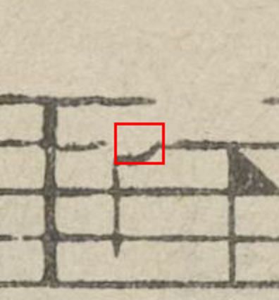
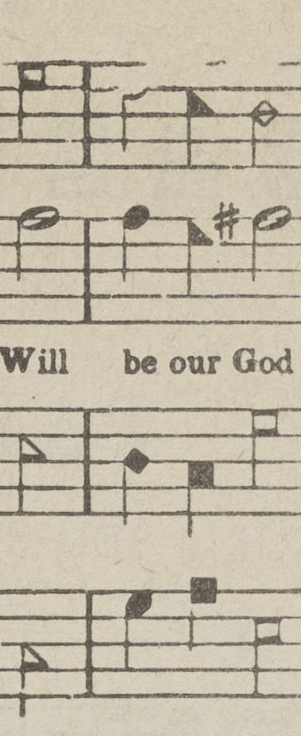
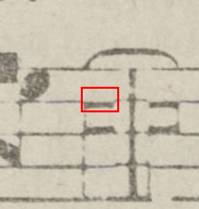

# Cross-book source review and conclusion

**The frozen line/blemish filter fails a source check on a legitimate damaged
notehead in J. L. White's 1911 Aylesbury. It is too aggressive on worn printing.**
The same rule correctly rejects a staff-line artifact in Supplication. No rule
was tuned or changed after seeing these target readings or results.

The fourteen source crops are seven matched tunes in each of the 1870 Sacred
Harp (MTS) and J. L. White 1911 (EMU) printings. Both original and cleaned layouts
were evaluated. These are independent printings of familiar tunes, not a new
claim about model-training data or whole-book accuracy.

## Every new source decision

The comparison found **two distinct source objects**, each affected in both
layout variants: four removal records across 28 paired configurations. There
were **no current-versus-prior emitted duration, dot, or type changes and no
changed common cuts**. The newer augmentation-dot and short-beam repairs were
not exercised in the emitted outputs; their cross-book benefit is unproven here.
There were no current-versus-prior output changes on the 1870 samples.

### Aylesbury: false-positive rejection

- Source input: `benchmarks/historical-sacred-harp/inputs/1911-Sacred-EMU-28t-aylesbury.png`.
- Original source and exact crop: sealed run `manifest.json`, scan 0034,
  source crop `[503, 252, 3689, 1258]`.
- Symbol 186, staff 0, box `[1825.8, 166.9, 1860.9, 195.5]` in crop coordinates.
- **Decision: a genuine damaged notehead was deleted. Its exact duration is
  not adjudicated by this review.**



The lower curved rim and attached downward stem establish a physical head,
despite missing upper/fill ink. The wider context shows its position at the
start of the bar, alongside parallel parts:



The verifier reports `no_head_ink`, ink fraction .186 and no enclosed counter.
After staff-line removal, the surviving curved fragment is only eight pixels
tall (about .25 staff spaces), below the rule's .35-space compact-component
threshold. Thus the rule treats an open/damaged counter and partial head as
staff-line/blemish evidence. The absence of an intact counter is insufficient
grounds for rejection. No alternate emitted head at this position remains on
the same physical staff.

In cleaned layout this deletion adds **one PD edit** and lowers F1 by **.00883**.
In the already faulty default layout it reduces PD by one, illustrating why
metric improvement alone cannot certify source correctness.

### Supplication: correct staff-line rejection

- Source input: `benchmarks/historical-sacred-harp/inputs/1911-Sacred-EMU-45b-supplication.png`.
- Original scan and crop are recorded in the sealed `manifest.json`.
- Symbol 211, staff 2, box `[2297.5, 660.9, 2335.2, 685.6]`.
- **Decision: correctly reject this extra note interpretation.**



The box encloses horizontal staff-line ink above a separate real source object;
it has no notehead or curved head rim. The retained real object below is not
the rejected box. The residual component is 30 by five pixels, consistent with
a thin line. Default-layout PD improves by one; cleaned-layout PD is unchanged.
Both timing F1 changes are small positive differences.

## Full-stage portability is also mixed

These are pooled **pitch-duration disagreement edits**, against edition-different
2025 references. They do not replace the physical source review.

| Cleaned-layout sample | Baseline reader | Earlier frozen rhythm stage | New frozen rhythm stage |
|---|---:|---:|---:|
| 1870 MTS, seven tunes | 191 | 177 | 177 |
| 1911 EMU, seven tunes | 400 | 417 | 418 |

The full rhythm stage improves reference agreement in the 1870 sample and
worsens it in the EMU sample. Its earlier and current versions both produce
unequal part-measure spans in **default-layout 1870 Aylesbury**, which already
has a wrong two-system layout. Twelve columns fail the span invariant in both
versions. The cleaned-layout case avoids that failure. All configurations stay
included; no output was repaired to pass this test.

This harness applies the frozen postprocessing to baseline event pools. It does
not recreate the JPK-specific upstream missing-head proposal experiments. Voice
orders and absent altos enter scoring only, never prediction. The 1911 JPK meter
template arrays are frozen and identical between the two rule snapshots; none
was learned from these historical target crops.

## Integrity and reproduction

All 28 CPU_ONLY baseline captures match the sealed pilot's musical XML exactly
(ignoring encoding date). The 28 earlier-rule and 28 newer-rule outputs completed
before reference scoring, with all source/adapter/engine hash guards passing.
Both frozen Copisteria implementations are byte-identical. The existing pilot
and JPK checkpoint files are preserved.

The Python-only snapshots omit the taxonomy asset; the adapter redirects that
resource lookup to the workspace asset, fingerprints it, and verifies its class
order against the frozen model manifest. It redirects the frozen runner's input
root and parent-event folder to this test's captured seeds. It does not alter a
rule function body or use target source meters/counts as prediction inputs.

The first adapter scoring command stopped on the newly exposed equal-span
failure. The separate `score_results.py` records and scores that failure instead;
the generation adapter and rule snapshots remain unchanged.

From the workspace root, use a **new tag** for another capture. Then run each
engine in a separate process before scoring:

```sh
copisteria/.venv/bin/python benchmarks/crossbook-frozen-rules/run_frozen_rules.py --phase capture --tag NEW_TAG
copisteria/.venv/bin/python benchmarks/crossbook-frozen-rules/run_frozen_rules.py --phase replay --engine prior --tag NEW_TAG
copisteria/.venv/bin/python benchmarks/crossbook-frozen-rules/run_frozen_rules.py --phase replay --engine current --tag NEW_TAG
copisteria/.venv/bin/python benchmarks/crossbook-frozen-rules/score_results.py benchmarks/crossbook-frozen-rules/runs/NEW_TAG
```

CoreML compilation may need the same sandbox escalation as the original pilot.
No inference is needed to rescore the saved current test.

**Recommended:** keep the stage opt-in and rework line/blemish rejection to
abstain on damaged heads before broader use. Use a fresh untouched sample for
the next transfer check; these diagnosed examples become development cases.

**Alternative:** apply these same unchanged snapshots to the other chat's
expanded sealed sample to measure how often this failure appears before changing
any rule. Defaults and gallery remain unchanged.
